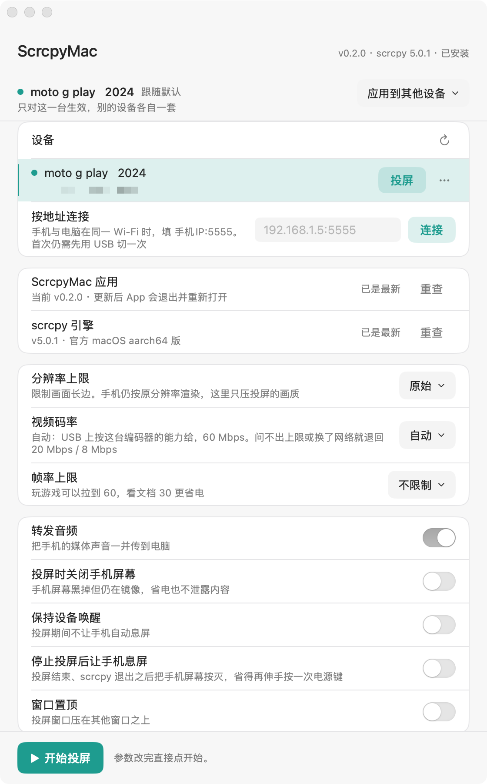
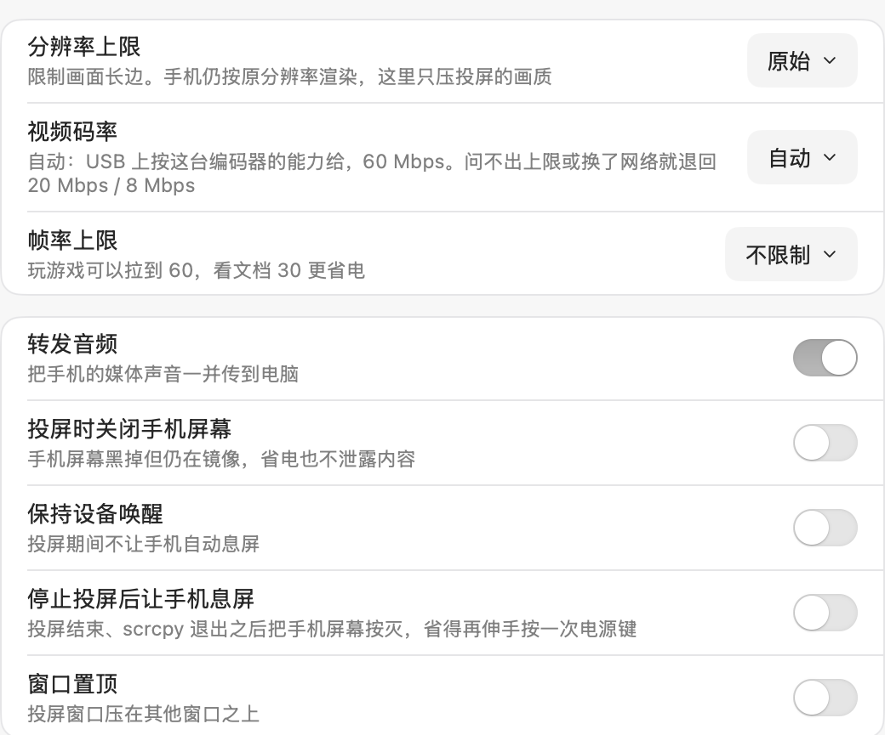
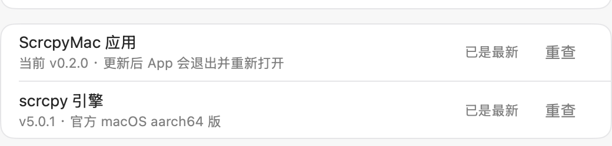

# ScrcpyMac

A native macOS wrapper around the [scrcpy](https://github.com/Genymobile/scrcpy)
command-line tool: it shows up in Launchpad, pins to the Dock, mirrors your phone
on double-click, and **updates itself through two independent channels** — the app
follows this repository's Releases, the scrcpy engine follows the official ones.

> Unofficial wrapper. scrcpy is by [rom1v](https://github.com/rom1v), licensed GPLv3.
> This project does not redistribute its binaries — see [NOTICE.md](NOTICE.md).



## Features

- **Devices** — lists `adb devices`, mirrors as many devices as you plug in, each controlled independently; USB; one-click move to Wi-Fi
- **Video** — max size, bit rate, frame rate cap
- **Behaviour** — audio forwarding, turn screen off, stay awake, always on top, sleep the phone when mirroring ends
- **Recording** — record to mp4 while mirroring, timestamped filenames
- **Advanced** — pass any extra scrcpy flag straight through
- **App updates** — checks this repository's latest release, verifies SHA256 and the code signature, then atomically swaps the bundle from inside the running app and restarts
- **Engine updates** — checks the latest `Genymobile/scrcpy` release, verifies SHA256, swaps in place

No key mapping (use QtScrcpy for that). Does not patch scrcpy — everything goes
through its command-line flags.

[escrcpy](https://github.com/viarotel-org/escrcpy) (Electron) and
[QtScrcpy](https://github.com/barry-ran/QtScrcpy) (Qt) are more feature-complete GUI
front-ends. ScrcpyMac is a small native SwiftUI shell that does not bundle scrcpy
and follows the official engine releases.

## Install

### Download

Grab the latest universal build from [Releases](https://github.com/vincerise/scrcpy-macos/releases),
unzip it, and drag `ScrcpyMac.app` into Applications.

The build is ad-hoc signed and not notarised. If macOS blocks the first launch,
right-click the app and choose **Open** on macOS 14 or earlier. On macOS 15 that
entry is gone; use **System Settings → Privacy & Security → Open Anyway** instead.

### Build from source

Requires Xcode (or Command Line Tools) and [XcodeGen](https://github.com/yonaskolb/XcodeGen):

```bash
brew install xcodegen
git clone https://github.com/vincerise/scrcpy-macos.git
cd scrcpy-macos
xcodegen generate
scripts/build.sh
scripts/install.sh
```

`scripts/install.sh` installs to `/Applications` and refreshes the Launchpad and
Dock caches.

### About the engine

The repository contains **no** scrcpy binaries. On first launch the app
**automatically** downloads one (~12 MB) from the official Releases into
`~/Library/Application Support/ScrcpyMac/engine/` — no button to press, it just
works after install.

To ship a build with the engine bundled (for an offline machine, say), run this
before building:

```bash
scripts/fetch-engine.sh                          # latest from official Releases
scripts/fetch-engine.sh /path/to/scrcpy-folder   # or copy from a local extract
```

> Note: **release artifacts do not bundle the engine.** Putting scrcpy's binaries
> inside the installer is redistribution, which triggers GPLv3's copyleft and
> would stop this project's own code from being MIT. Bundling a seed in your own
> local build is personal use and distributes nothing.

## Usage

1. Enable *Developer options → USB debugging* on the phone, connect over USB
2. Tap **Allow** on the "Allow USB debugging?" prompt
3. Open ScrcpyMac; once your phone shows up in the device list, hit **投屏** on its row

**Multiple devices** — plug in as many as you like; each gets its own row with its
own *投屏 / 停止* button. The bar at the bottom is the global one: *开始投屏* with a
single device, *全部投屏* with several, plus *投屏另外 n 台* while something is
already running so a device plugged in later can join without stopping the rest.
Each mirrored device is its own scrcpy process controlling its own phone. Windows
are cascaded by default (turn it off under *Behaviour*), and the log console can
filter down to one device. Emulators are never listed: they already run on this
machine, so mirroring one would just duplicate the screen you are looking at.

> Do not mirror the same phone over USB and Wi-Fi at once — those are two
> different serials, so the app treats them as two devices, but there is only one screen.

**Per-device settings** — resolution cap, bit rate, frame rate cap, audio forwarding,
whether to switch the phone's screen off while mirroring, whether to sleep it on stop,
always-on-top, recording, extra arguments: each of these is stored **per device**.
The device row *is* the selector: **click a row to select it** and the cards below
now edit that device. The scope bar above the cards says whether it *follows the
default* (跟随默认) or has *its own settings* (单独设置).



Three more actions live in the row's `⋯` menu, because they touch *other* devices:

| Action | What it does |
| --- | --- |
| 恢复默认参数 | This device goes back to following the default; the others are untouched |
| 把这台设为默认 | Makes this device's values the default — **only for devices plugged in later**; devices already in use keep theirs |
| 应用到所有 n 台设备 | Overwrites every other device with this one's values (only offered with two or more devices) |

With no devices plugged in the cards edit the **default settings**, i.e. what the next
device to show up will start from.

Changing a setting mid-mirror does not interrupt the running session: the command line
is fixed when scrcpy starts, so **your change applies to the next launch** (the scope
bar says so while a device is mirroring).

*Cascade windows*, *recording folder* and the *adb path* stay global and live in the
last card.

**Getting a mirror window back** — a mirror window belongs to its own scrcpy process,
so once it is buried there are several ways to bring it forward: double-click the
device row, pick *显示投屏窗口* from the row's `⋯` menu, or right-click the Dock icon
(that menu lists every device currently mirroring). Clicking the Dock icon plain
brings the panel and all mirror windows forward together.

The control panel always sits above the mirror windows; that is how macOS activation
works. When you ask for a mirror window and the panel happens to cover it, the app
moves the panel itself out of the way.

**Sleep on stop** — turn on *停止投屏后让手机息屏* under Behaviour and the phone's
screen is switched off once mirroring ends (either you hit stop or you close the
mirror window). It fires *after* scrcpy exits, because with *turn screen off* enabled
scrcpy restores the screen to on as it quits.

**Going wireless** — pick *切换到无线* from the row's `⋯` menu. Once it succeeds you
can unplug; both devices must be on the same network. Wireless devices stay in the
same list, and *断开连接* lives in the same `⋯` menu.

**Updates** — the card has two independent rows: *ScrcpyMac 应用* follows this
repository's releases, *scrcpy 引擎* follows `Genymobile/scrcpy`. Each row checks and
downloads on its own; **Check for Updates…** in the menu triggers both. A quiet check
also runs on every launch and only speaks up when something new is found.



Once an app update is downloaded and verified, the button becomes *Restart and update
to x.y.z*. Clicking it makes the app **replace its own bundle in place** and quit; a
background helper waits for it to exit, reopens the new version, and rolls back if the
new one does not confirm within 30 seconds. You can check and download while mirroring,
but restarting requires stopping the mirror first; an engine update in progress also
blocks app installation.

Engine updates swap the engine in place once verified and take effect on the next
mirror. Updates are blocked while mirroring, and **installing is your call**: scrcpy
has changed command-line flags across major versions.

## How it works

### The engine lives outside the app bundle

```
ScrcpyMac.app/Contents/Resources/engine-seed/        ← read-only seed, sealed by the signature
~/Library/Application Support/ScrcpyMac/engine/      ← the copy updates replace
~/Library/Application Support/ScrcpyMac/Mirror.app/  ← mini bundle the child is launched from
```

At runtime the engine is resolved Application Support first, falling back to the
bundled seed. A build without a seed (the default for a fresh clone) therefore
downloads one on first launch, while a seeded build works immediately — until the
first "Check for updates", after which the Application Support copy takes over.

The engine lives outside the bundle, and engine updates **never write to the bundle**:

- An ad-hoc signature seals `Resources/`; replacing a binary there changes the
  `cdhash`, which invalidates every TCC grant — the local-network prompt returns
  every launch, and once a user has tapped "Don't Allow" it never asks again,
  so wireless adb fails silently
- Launching straight from an archive gets the app mounted at a random read-only
  path (App Translocation), where writing to the bundle cannot work at all
- If the app is owned by root, writing needs escalation

Moving the engine out removes all of these at once, and engine updates need no re-signing.

App updates are the one exception: they replace the whole bundle when the user asks
for it, so the signature changes and macOS may ask for Local Network access again.
That follows from ad-hoc signing having no stable identity; allow it once more — see
Troubleshooting.

### Signing

Ad-hoc (`codesign -s -`), no Developer ID. Locally built apps carry no quarantine
flag, so no "unidentified developer" prompt. That changes the moment you hand the
build to someone else — an ad-hoc signature can never be notarised.

Signing deliberately omits `--deep`: the bundled `adb` carries Google's Developer
ID signature, and `--deep` would re-sign it to ad-hoc, destroying it.

### Updates

The two channels are independent.

**The app**

```
GET /repos/vincerise/scrcpy-macos/releases/latest   (with ETag; 304 short-circuits)
  → ScrcpyMac-v<ver>-macos-universal.zip
  → verify SHA256: the API's asset digest first, otherwise SHA256SUMS.txt;
    if both exist they must agree, if neither exists installation is refused
  → ditto extract; exactly one .app
  → codesign --verify --strict (no --deep) + bundle id / version /
    architecture / minimum OS
  → user clicks "Restart and update"
  → renamex_np(RENAME_SWAP) swaps the bundle atomically inside the running process
  → helper waits for the old process to exit, reopens; rolls back after 30s
```

`codesign` only proves the bundle is intact; an ad-hoc signature has no identity, so
anyone can re-sign a copy. The actual trust anchor is the HTTPS-downloaded release
asset and its SHA256.

The swap happens inside the app's own process rather than in the helper: since macOS 13,
App Management restricts "another process modifying an app bundle" more aggressively,
while an app modifying itself usually needs no extra grant. `renamex_np` fails on
non-APFS volumes; that is reported as an error rather than falling back to two
non-atomic renames, which could leave an unbootable launch path after a crash.

The new version writes an ack file on launch; the helper deletes the old bundle only
after reading a matching version. Versions predating this mechanism have no ack, so
the helper treats a process that stays alive for 5 seconds as success. If the new
version fails to launch it is reopened a few times; if it still fails, the old bundle
is swapped back and reopened.

**The engine**

```
GET /repos/Genymobile/scrcpy/releases/latest   (with ETag; 304 short-circuits)
  → pick scrcpy-macos-{aarch64,x86_64}-v<ver>.tar.gz for this machine
  → download, verify against the same release's SHA256SUMS.txt
  → untar → strip xattrs → smoke-test with scrcpy --version
  → atomic swap via two renames on the same filesystem
```

The engine swap must replace everything: the `scrcpy` client and `scrcpy-server` are
version-locked and a mismatch is refused at startup.

Note on verification: `SHA256SUMS.txt` comes from the same release as the tarball,
so it proves the download is intact but **not** that upstream was not compromised.
The real trust anchor is the `.asc` signature next to it, which would require gpg.

### The child process gets no Dock tile

scrcpy's SDL3 Cocoa backend sets the process to
`NSApplicationActivationPolicyRegular`, so a second icon appears in the Dock and
it takes over the menu bar. To get accessory policy — no Dock tile, no menu bar,
but a window that still activates and takes keyboard and mouse — two things have
to be true at once:

1. **The child must live inside a bundle that carries `LSUIElement`.** AppKit
   picks the default activation policy from whether the process is in a bundle:
   a bare binary gets prohibited, a bundle with `LSUIElement` gets accessory. So
   instead of exec'ing the engine's `scrcpy` directly, we exec one inside a tiny
   bundle at `~/Library/Application Support/ScrcpyMac/Mirror.app`
   (`Contents/Info.plist` with `LSUIElement`; `Contents/MacOS/scrcpy` hard-linked
   to the current engine, falling back to a copy across volumes).
2. **`SDL_MAC_BACKGROUND_APP=1` must be set.** Until it sees that hint, SDL calls
   `setActivationPolicy:Regular` itself and overrides the bundle's `LSUIElement`.

Step 2 alone does not work either: a bare binary plus the hint comes out
prohibited, so the icon is gone but the window never appears. The mini bundle is
rebuilt on each launch (nothing is written when it already matches), so `scrcpy`
and `scrcpy-server` stay version-locked after an engine update.

## Troubleshooting

**Phone stuck on "unauthorized"** — there should be an "Allow USB debugging?"
prompt on the phone. If it never appears, replug the cable, or use
*Revoke USB debugging authorizations* in Developer options and reconnect.

**Wireless connects fail** — make sure both devices are on the same network with
no AP isolation. From macOS 15, `adb connect` triggers the Local Network privacy
prompt; if it was ever denied it will not ask again — re-enable it under
*System Settings → Privacy & Security → Local Network*.

**scrcpy server still running on the phone after quitting** — a normal quit
(⌘Q or closing the window) sends SIGTERM and scrcpy cleans up after itself. Only a
forced kill (`kill -9`) can leave residue, and the next launch reaps it.

**Why one phone over USB and Wi-Fi shows up twice** — `adb` sees two devices: the USB
serial is the hardware serial, the wireless one is `IP:port`. They also keep separate
settings; to make them match, use *应用到所有 n 台设备* in one row's `⋯` menu. Everything
stored per device lives under the single key `scrcpy.deviceSettings`; to wipe it:

```bash
defaults delete com.vincerise.scrcpymac scrcpy.deviceSettings
```

**Which video bit rate to pick** — *自动* (auto). Over USB it takes the ceiling the
phone's own encoder declares (read from `media_codecs*.xml` on the device; 40–100 Mbps
on most phones); over Wi-Fi it uses 8 Mbps. Older phones whose ceiling can't be read
get 20 Mbps over USB, which is visually lossless at 1080p60. The dropdown only lists
rates this device can honour; to go past them anyway, use `--video-bit-rate` under
*额外参数*.

**Can I update just one of them?** — Yes. Each row has its own *Check for Updates*;
the menu's **Check for Updates…** is the one that checks both.

**The app-update button is greyed out** — the hint under the row says why: mirroring is
active, an engine download or install is in progress, another instance with the same
bundle id is running, the location is read-only or not writable, or the app is running
straight from an archive (App Translocation). Move the app into Applications and try
again. If App Management is the blocker, allow ScrcpyMac under *System Settings →
Privacy & Security → App Management*.

**Local Network permission came back after an app update** — ad-hoc signing has no
stable identity, so a new bundle means a new `cdhash` and macOS treats it as a different
app. Allow it once; this can repeat after every update until the build has a Developer
ID and is notarised.

**Can a failed update brick the app?** — Not silently. The archive is fully verified
before the swap, and the version is read back immediately after it; the helper rolls
back and reopens the old version if the new one never confirms. In the worst case where
neither launches, download the release again — settings and the engine live under
`~/Library/Application Support/ScrcpyMac/` and are untouched.

**"Rate limit exceeded" when checking** — GitHub allows 60 anonymous API requests per
hour, shared by both rows. Wait a bit and try again.

## Development

```
ScrcpyMac/
├── App/        entry point, menus, AppDelegate
├── Design/     theme and shared components
├── Engine/     locating, seeding and atomically swapping the engine
├── Device/     adb invocation and output parsing
├── Session/    lifecycle of the scrcpy child process
├── Update/     app and engine update check, download, verify, install
├── Model/      preference persistence
└── UI/         main window and view model
```

`project.yml` is the single source of truth; `.xcodeproj` is not committed. After
adding or removing Swift files, run `xcodegen generate`.

For a release, `scripts/release.sh` reads the version from `project.yml`, builds a
universal app with no engine seed, checks the signature and architectures, writes
`SHA256SUMS.txt`, and prints the `gh release create` command (it does not publish).

## License

This project's code is [MIT](LICENSE). scrcpy is by rom1v, GPLv3; adb is by
Google, Apache-2.0. See [NOTICE.md](NOTICE.md).
